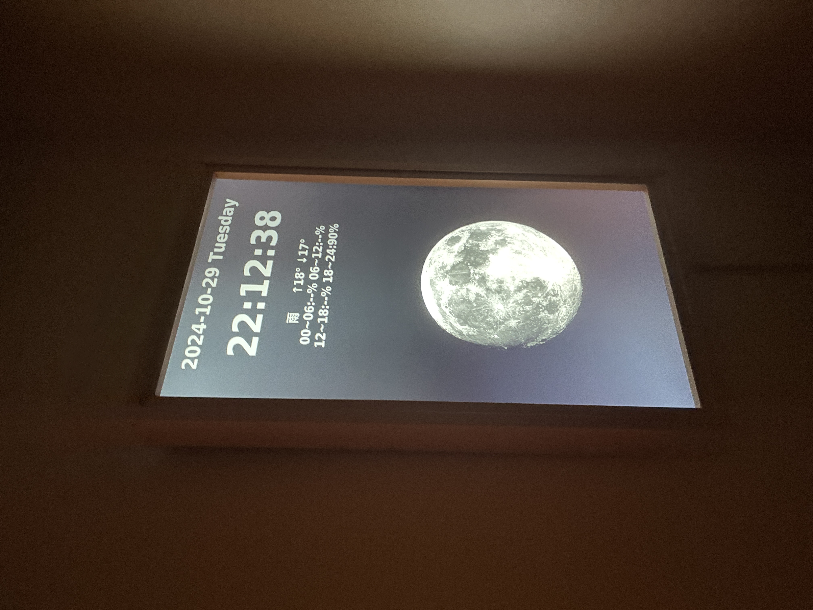
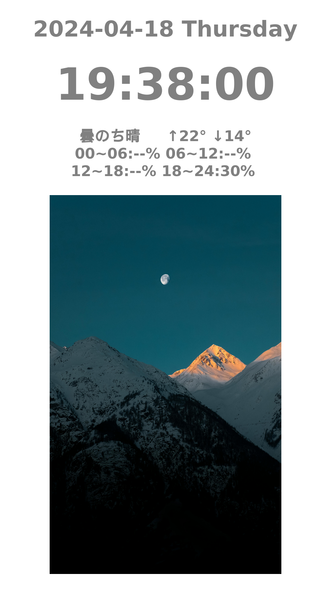
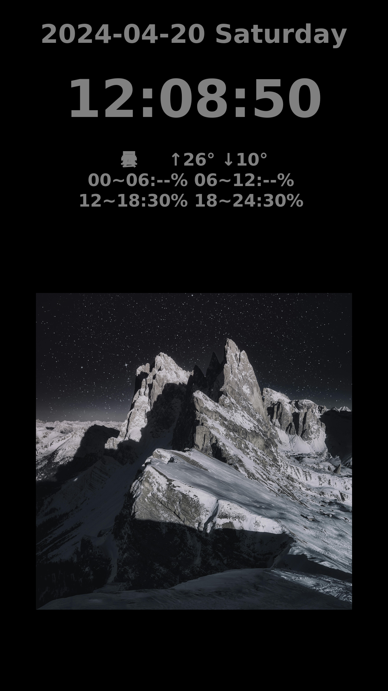
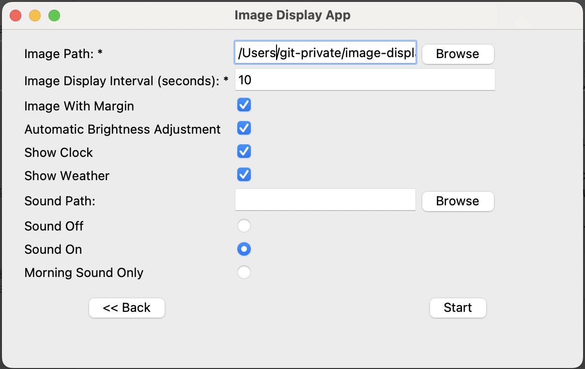
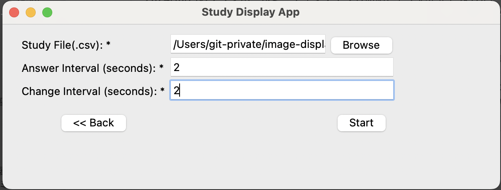

# Image Display App
**思い出の写真を飾り、好きなアートを楽しみながら、日々の時間と天気を確認できるインターフェース**

<div style="display: flex; gap: 10px;">
    
    
    
    
</div>

# 📋 主な機能
- 画像表示：写真やアートをランダムに表示
- 時計表示：シンプルな時計を画面に
- 天気と降水確率の確認：日々の天気
- 列車時刻表表示：最寄り駅の列車時刻を表示
- 自動調整：時間帯に応じた明るさ調整
- 単語学習：単語を自動表示し、日々の学習に

# 🌄 イメージ
<div style="display: flex; gap: 10px;">
    
    
</div>

**日付時間 + 天気予報 + ランダム画像**
（左）**昼間**：明るさが最大に設定
（右）**夜間**：画面が暗くなり、眩しくない


**画像表示モード**: アート作品や写真を飾るイメージ。


**勉強モード**: 暗記として使える機能。時間とともに覚えたい単語を表示

# 🖥️ システム要件

* **Python 3.10 以降**
* **Tkinter**（GUI。Python に同梱、または `python-tk` で別途インストール）
* Python パッケージ（`requirements.txt` に記載）:
    - **requests**（ウェブデータ取得）
    - **beautifulsoup4**（天気サイトの解析）
    - **pillow**（画像処理）
    - **pygame-ce**（BGM 再生。`pygame` の後継で新しい Python に対応）

# 🚀 インストール手順

### 1. Python と Tkinter

macOS（Homebrew）の例:
```zsh
brew install python python-tk
```

> Linux の場合は `sudo apt install python3 python3-tk` など、ディストリビューションのパッケージマネージャを利用してください。

### 2. 依存パッケージのインストール（仮想環境を推奨）

プロジェクト直下に仮想環境を作り、その中にインストールします。
```zsh
cd image-display-app
python3 -m venv .venv
source .venv/bin/activate
pip install -r requirements.txt
```

> 仮想環境を使うと、このアプリ専用にパッケージを隔離でき、システムの Python を汚しません。

# 📓 利用方法
仮想環境を有効化した状態で実行します。
```zsh
source .venv/bin/activate   # 起動のたびに有効化（プロンプトに (.venv) が付く）
python main.py
```
有効化が面倒な場合は、仮想環境の Python を直接指定しても起動できます。
```zsh
.venv/bin/python main.py
```

# 👏 動作画面の様子


起動すると以下の2つのモードを選択できます。
- 画像表示モード
- 勉強モード

## 🖼 Image Mode


### - 設定

- **Auto Image**: 画像をネット上から自動取得（オフのときは Image Path のフォルダから表示）
- **Image Path**: 画像フォルダのパス
- **Display Interval (seconds)**: 画像が切り替わるまでの時間（秒）
- **Automatic Brightness Adjustment**: 時間帯に応じて明るさを自動調整
- **Show Clock**: 時間を表示するか否か
- **Show Weather**: 天気を表示するか否か
- **Show Train Schedule**: 列車時刻表を表示するか否か
- **Sound Path**: BGM フォルダのパス
- **Sound Off / Sound On / Morning Sound Only**: BGM の再生モード（オフ / 常時 / 朝のみ）

### - キーバインド
- `<Escape>` / `<q>`: 終了する
- `<b>`: 文字（時計・天気など）の明るさ調整
- `<i>`: 画像の明るさ調整
- `<f>`: フルスクリーン切り替え
- `<h>`: カーソル表示切り替え
- `<v>`: 音量の調整
- `<m>`: ミュートの切り替え
- `<Space>`: 次の画像に移動する

## 🧠 Study Mode


### - 設定

- **Study File (.csv)**: 問題ファイル（1列目に問題、2列目に答え）
- **Answer Interval (seconds)**: 答えが出るまでの時間（秒）
- **Change Interval (seconds)**: 問題が変わるまでの時間（秒）

### - キーバインド
- `<Escape>` / `<q>`: 終了する
- `<Space>`: 暗記完了（ループから削除され、もう表示されない）
- `<b>`: 明るさ調整
- `<f>`: フルスクリーン切り替え
- `<h>`: カーソル表示切り替え

# 🗂 ディレクトリ構成
```
main.py                       エントリポイント
config.py                     調整値・地域固有データ（天気地点/路線/フォント/明るさ時間帯）
screens/                      画面（tkinter UI）
  home_screen.py              モード選択
  image_mode_screen.py        画像表示モード（中心機能）
  image_mode_setting_screen.py  画像モードの設定
  study_mode_screen.py        勉強モード
  study_mode_setting_screen.py  勉強モードの設定
  mixins.py                   画面共通のウィンドウ操作
services/                     外部データの取得
  fetch_weather_from_tenkijp.py  天気の取得（tenki.jp）
  fetch_train_schedule.py     時刻表から次の列車を計算
  fetch_image_from_pixel.py   ネットから画像を自動取得
utils/                        汎用ヘルパー
  settings_manager.py         設定の読み書き（.settings.json）
  ui.py                       設定画面の共通 UI ヘルパー
  music_player.py             BGM 再生
data/                         列車時刻表 JSON
```

> 地域や路線、表示の調整値を変えたい場合は基本的に **`config.py`** を編集するだけで済みます。

# 💡 Tips
Linux 環境では以下のような `.desktop` ファイルを作成すると、毎回 `python main.py` を入力せずにクリックで起動できます。
```image_display_app.desktop
[Desktop Entry]
Name=Image Display App
Exec=/path/to/image-display-app/.venv/bin/python /path/to/image-display-app/main.py
Icon=/path/to/asset/icon.jpeg
Terminal=true
Type=Application
Categories=Utility;
```

## 🌐 おすすめ画像収集サイト
画像収集サイト：
https://www.pexels.com/ja-jp/search/%E9%A2%A8%E6%99%AF/

絵画収集方法：
https://sleepygamersmemo.blogspot.com/2018/11/download-from-wikiart-with-tampermonkey.html

# ❗️ 注意
使用は自己責任です
